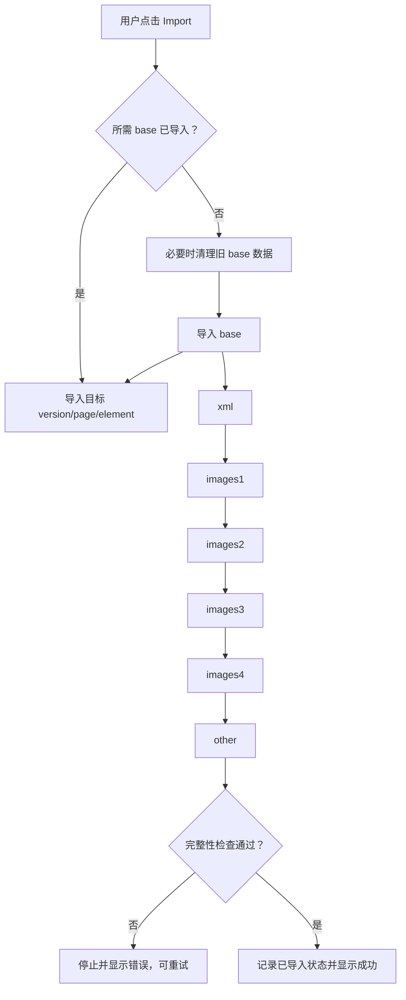
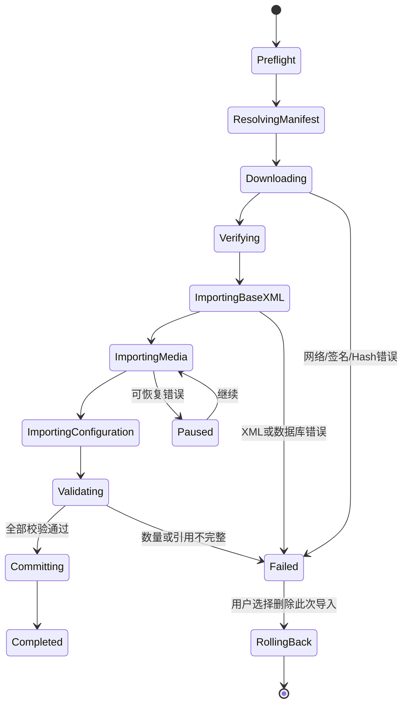

# SHOPAGG 主题：预建网站技术说明与远程服务设计

> 文档状态：基于当前代码的实现分析与后续改造方案<br>
> 分析日期：2026-08-12<br>
> 适用范围：`shopagg-woo-theme` 主题（内部兼容标识仍为 `woodmart`）、`shopagg-woo-theme-core` 插件、`shopagg-app-store` WordPress 插件，以及 SHOPAGG Laravel 服务端

## 1. 结论摘要

当前 **Prebuilt websites** 并不是“从远程 API 下载完整网站模板后导入”，而是一个混合方案：

- 模板目录、导入规则、WXR XML、主题选项、组件、页眉等数据随主题一起发布；
- 模板预览图、在线演示站和 XML 中引用的媒体文件来自 XTemos 远端；
- WordPress 后台通过多个 AJAX 请求分阶段导入本地数据，并在导入 XML 时逐个下载远程附件；
- 商品本身来自本地 XML，商品图片来自远程附件地址；远程附件不可访问时，商品可以部分创建，但图片、缩略图及依赖附件 ID 的设置会缺失；
- 当前仓库共有 189 个模板配置：27 个 `base`、99 个 `version`、23 个 `page`、40 个 `element`；本地 dummy data 约 209MB。

当前 SHOPAGG 代码已增强导入结果校验：只有 XML 声明的商品和附件达到预期数量，才允许进入“成功”状态。这解决了“请求结束即提示成功”的误判，但仍未把模板数据迁移到 SHOPAGG 远程服务。

推荐的目标架构是：

1. SHOPAGG 服务端管理模板目录、模板发布版本、构建器变体、数据包、媒体和完整性清单；
2. `shopagg-app-store` 复用现有 Token、API 客户端和 5 分钟签名下载链接；
3. 主题只负责导入器及 UI，通过一个 Provider 接口读取远程 manifest，插件未启用或远端不可用时可回退到随主题发布的本地模板；
4. 下载后的模板包必须校验 SHA-256、结构、兼容性和文件白名单，再进入可恢复的分阶段导入；
5. 完成条件必须以“预期数量、ID 映射、附件文件存在、关键页面及设置可解析”为准，而不能以 AJAX 请求返回为准。

## 2. 代码范围

### 2.1 主题端

| 职责 | 文件 |
| --- | --- |
| 后台页面、模板卡片、AJAX 入口 | `inc/admin/modules/import/class-import.php` |
| 导入步骤编排、状态和完整性检查 | `inc/admin/modules/import/class-process.php` |
| 文件定位、构建器识别、URL 替换 | `inc/admin/modules/import/class-helpers.php` |
| WXR 导入后的 ID/内容替换 | `inc/admin/modules/import/class-xml.php` |
| 主题选项及 Preset 导入 | `inc/admin/modules/import/class-options.php` |
| 小工具导入 | `inc/admin/modules/import/class-widgets.php` |
| Header Builder 数据导入 | `inc/admin/modules/import/class-headers.php` |
| 首页和菜单调整 | `inc/admin/modules/import/class-menu.php` |
| 导入前初始化 | `inc/admin/modules/import/class-before.php` |
| 导入后的 WooCommerce、URL、构建器处理 | `inc/admin/modules/import/class-after.php` |
| 缩略图和图片 ID 映射 | `inc/admin/modules/import/class-images.php` |
| 已导入内容的选择性清理 | `inc/admin/modules/import/class-remove.php` |
| 浏览器端状态机 | `inc/admin/assets/js/import.js` |
| 模板目录及导入规则 | `inc/configs/versions.php` |
| 随主题发布的模板数据 | `inc/admin/modules/import/dummy-data/{slug}/` |

### 2.2 插件与服务端

| 职责 | 文件 |
| --- | --- |
| 实际 WXR 导入及附件下载 | `wp-content/plugins/shopagg-woo-theme-core/importer/class-import.php` |
| SHOPAGG WordPress API 客户端 | `wp-content/plugins/shopagg-app-store/includes/class-api-client.php` |
| SHOPAGG Token 管理 | `wp-content/plugins/shopagg-app-store/includes/class-auth.php` |
| SHOPAGG 插件/主题更新 | `wp-content/plugins/shopagg-app-store/includes/class-updater.php` |
| Laravel App Store API 路由 | `app/Modules/ShopaggAppStore/Routes/api.php` |
| Laravel 签名下载 | `app/Modules/ShopaggAppStore/Controllers/DownloadController.php` |
| Laravel 资源版本 | `app/Modules/ShopaggAppStore/Models/ResourceVersion.php` |

## 3. 当前数据来源与配置模型

### 3.1 远端常量

主题当前定义以下 XTemos 地址：

```text
WOODMART_API_URL      = https://xtemos.com/wp-json/xts/v1/
WOODMART_DEMO_URL     = https://woodmart.xtemos.com/
WOODMART_PLUGINS_URL  = https://woodmart.xtemos.com/plugins/
WOODMART_DUMMY_URL    = https://woodmart.xtemos.com/dummy-content-new/
```

Prebuilt websites 直接使用的远端内容主要是：

- 模板卡片：`{WOODMART_DUMMY_URL}/{slug}/preview.jpg`；
- 在线演示：`versions.php` 的 `link`，或从 `WOODMART_DEMO_URL` 派生；
- 媒体源：WXR 的 `<wp:attachment_url>`；
- 媒体 CDN 回退：`https://woodmart-dummy.b-cdn.net/`。

主题更新 API、主题插件 ZIP 和 Prebuilt websites 是不同链路，不应把 `WOODMART_API_URL` 的主题更新接口误认为模板数据接口。

### 3.2 模板配置

`versions.php` 是当前唯一的模板目录。典型展示模板：

```php
'keyboards' => array(
    'title'      => 'Keyboards',
    'process'    => 'xml,home,options,widgets',
    'type'       => 'version',
    'base'       => 'keyboards_base',
    'link'       => 'https://woodmart.xtemos.com/keyboards/',
    'categories' => array(...),
),
```

典型基础模板：

```php
'keyboards_base' => array(
    'title'   => 'Base content keyboards (required)',
    'process' => 'xml,xml_images,widgets,options,headers',
    'type'    => 'base',
    'links'   => array(
        'wpb'       => 'https://dummy.xtemos.com/.../',
        'elementor' => 'https://dummy.xtemos.com/.../',
        'gutenberg' => 'https://dummy.xtemos.com/.../',
    ),
    'uploads_link' => array(...),
),
```

类型含义：

| 类型 | 数量 | 作用 |
| --- | ---: | --- |
| `base` | 27 | 公共商品、媒体、菜单、分类、页眉和基础设置 |
| `version` | 99 | 一个完整演示站的首页及差异化设置，依赖某个 base |
| `page` | 23 | 单页导入 |
| `element` | 40 | HTML Block、布局、弹窗、Floating Block 等功能元素 |

`process` 是逗号分隔的能力声明：

| 标记 | 行为 |
| --- | --- |
| `xml` | 导入主要 WXR 数据 |
| `xml_images` | 导入拆分的附件 XML；浏览器依次处理 `images1` 至 `images4`，每个文件再按小批次续传 |
| `widgets` | 导入 sidebars/widgets |
| `options` | 导入主题设置和 Preset |
| `headers` | 导入 Header Builder JSON |
| `home` | 设置首页及菜单首页项 |
| `images` | 根据映射写入文章、商品、分类缩略图 |

### 3.3 随主题发布的数据文件

每个 slug 的目录可以包含：

```text
content.xml
content-elementor.xml
content-gutenberg.xml
content-images1.xml ... content-images4.xml
content-elementor-images1.xml ... content-elementor-images4.xml
content-gutenberg-images1.xml ... content-gutenberg-images4.xml
options.json / options-elementor.json / options-gutenberg.json
widgets.json / widgets-elementor.json / widgets-gutenberg.json
images.json / images-elementor.json / images-gutenberg.json
header-1.json ... header-5.json（以及构建器变体）
presets.json
options_presets.json
configs.json
```

文件按当前页面构建器选择：原生编辑器映射到 `gutenberg`，其余为 WPBakery 或 Elementor。不存在构建器专用文件时，部分模块会回退到无后缀文件。

## 4. 当前后台与导入状态机

### 4.1 页面初始化

访问 `wp-admin/admin.php?page=xts_prebuilt_websites` 时：

1. `Import::set_versions_list()` 读取并缓存 `versions.php`；
2. base 项不作为普通模板卡片展示；
3. 根据当前构建器过滤不兼容的 Gutenberg 模板；
4. 检查 SHOPAGG 主题核心、WooCommerce、页面构建器、DOMDocument、SimpleXML 和站点协议；
5. 渲染分类筛选、模板卡片、预览图、导入按钮和清理入口；
6. 管理端脚本获得 AJAX URL、导入 nonce、删除 nonce、base slug 列表等配置。

### 4.2 AJAX 契约

导入请求：

```http
GET /wp-admin/admin-ajax.php
    ?action=woodmart_import_action
    &version=keyboards_base
    &type=base
    &process=xml
    &security={nonce}
```

可能额外携带 WordPress 文件系统/FTP 凭据。服务端用 `check_ajax_referer('woodmart-import-nonce', 'security')` 校验 nonce。

成功响应：

```json
{
  "preview_url": "https://local.example/",
  "remove_html": "<div>...</div>",
  "has_more": true,
  "next_offset": 3,
  "success": true
}
```

失败响应：

```json
{
  "success": false,
  "data": {
    "errorCode": "shopagg_import_media_incomplete",
    "errorMessage": "Image import is incomplete (18 of 96)..."
  }
}
```

### 4.3 浏览器端步骤



浏览器按以下阶段执行：

```text
xml → images1 → images2 → images3 → images4 → other
```

每个 `imagesN` 默认只处理 3 个附件；服务端返回 `has_more=true` 时，浏览器用 `next_offset` 重复当前阶段，直到该 XML 完成。这样单个 AJAX 不会因为几十张远程图片串行下载而运行数分钟，已完成批次也可在重试时复用。非 base 模板跳过 `images1..4`。目标是 `version` 且其 base 尚未导入时，先执行一次完整 base 链，再执行目标 version 链。

当前脚本仅在 AJAX `success` 回调且业务响应成功时继续下一步。任何 HTTP 错误、超时或 `success:false` 都会终止链路，避免旧实现中 Promise 继续推进后错误显示成功。

## 5. 服务端导入过程

### 5.1 `xml`：文章、商品、分类及关系

`Process` 根据 `process` 声明决定是否实例化 `XML`。`XML` 选择当前构建器对应的 `content*.xml`，再调用 SHOPAGG 主题核心的 WXR Importer：

1. 解析作者、分类、标签、taxonomy、posts、comments 和 meta；
2. 不存在的文章类型会被跳过，因此 WooCommerce 和 SHOPAGG 主题核心必须在导入前启用；
3. 商品、变体、页面、HTML Block、菜单项等通过 `wp_insert_post` 导入；
4. 菜单项单独处理对象关系；
5. 导入后补齐父子关系、附件 URL 和特色图片；
6. 保存源 ID 到本地 ID 的映射。

商品不是由远端商品 API 创建，而是 WXR 内的 `post_type=product` 和相关 meta/terms 创建。因此“商品未导入”通常表示：

- WooCommerce 未启用，导致 `product` 类型无效；
- XML 步骤中断或解析失败；
- 旧状态误判为已导入而跳过 XML；
- 已存在相同标题和日期的内容被映射为现有内容；
- PHP 内存、执行时间、请求体或数据库约束导致部分写入。

### 5.2 `images1..4`：远程附件

附件 WXR 仍在本地，但每个附件包含远程 URL，例如：

```xml
<wp:attachment_url><![CDATA[
http://dummy.xtemos.com/woodmart2/keyboards-elementor/wp-content/uploads/sites/71/...
]]></wp:attachment_url>
```

实际下载行为在 SHOPAGG 主题核心 Importer 中：

1. 将 `http:` 规范化为 `https:`；
2. 可把 `dummy.xtemos.com` 改写为 `woodmart-dummy.b-cdn.net`；
3. 使用 `wp_safe_remote_get()` 流式写入临时文件；
4. SHOPAGG 导入请求直接使用 CDN，单文件超时 15 秒、当前批次尝试 1 次；
5. 每个 AJAX 默认处理 3 个附件，返回下一批 offset；
6. 校验 HTTP 200、Content-Type、文件类型和大小；
7. 写入 WordPress uploads，创建 attachment，生成 attachment metadata；
8. 失败记录到 WooCommerce 日志，日志 source 为 `failed-import-images`。

当前 SHOPAGG 分支在导入 AJAX 期间，仅对白名单主机 `dummy.xtemos.com` 和 `woodmart-dummy.b-cdn.net` 放行 WordPress 的安全 URL 检查。该处理用于本地代理把公网域名解析为私网地址的环境，不应扩大为任意主机白名单。

### 5.3 源 ID 到本地 ID 映射

Importer 将映射写入：

```text
wd_imported_data_{version}
```

结构要点：

```php
array(
    'all_posts' => array(
        $old_id => array('old' => ..., 'new' => ..., 'post_type' => ...),
    ),
    'product'    => array(...),
    'attachment' => array(...),
    'page'       => array(...),
    'term'       => array(
        'product_cat' => array(...),
        'nav_menu'    => array(...),
    ),
    'headers' => array(...),
)
```

后续模块必须使用该映射，不能直接保留演示站 ID。映射被用于：

- 特色图片、商品图、商品分类图；
- Elementor/WPBakery/Gutenberg 内容；
- Header Builder 中的图片和 HTML Block；
- widgets 的菜单、图片、HTML Block；
- 主题选项中的附件、页面和自定义字体；
- term meta、post meta、菜单对象及父子关系。

### 5.4 `other`：配置和收尾

`other` 开始时先检查 XML 声明的预期商品数和附件数。当前实现扫描主 XML 及 `images1..4`，与 `wd_imported_data_{version}` 中已导入数量比较。数量不足立即返回 `WP_Error`，不会写入成功标志。

通过校验后按配置执行：

1. Widgets：清空对应 widget area，导入新 widgets，并替换菜单/附件/HTML Block ID；
2. Options：导入主题设置、Preset、options preset，保留当前构建器，清理动态 CSS 缓存；
3. Headers：读取最多五份 Header JSON，替换 URL 和对象 ID，通过 Header Builder 创建；
4. Home/Menu：找到 `Home {version}`，设置静态首页并更新指定菜单的 Home 项；
5. Images：应用 `images*.json` 的缩略图映射；
6. base 专属收尾：菜单位置、Blog/Shop 页面、构建器支持的 post types、注册设置、WooCommerce lookup table、图片尺寸等；
7. 按 `links/uploads_link` 把演示站 URL 替换为本站首页和 uploads URL；
8. 清理缓存，触发 `woodmart_after_import`。

### 5.5 成功状态

仅在 `other` 完整完成后写入：

| Option | 含义 |
| --- | --- |
| `wd_import_imported_versions` | 已导入的 slug 列表 |
| `wd_import_theme_version` | 导入时主题版本 |
| `wd_import_current_version` | 当前展示模板 |
| `wd_import_current_base` | 当前基础模板 |
| `woodmart_setup_status` | 设置向导已完成 |
| `wd_imported_data_{slug}` | 该 slug 的对象和 ID 映射 |

## 6. 清理与重试

切换到不同 base 时，前端会提示删除旧演示数据。清理接口使用单独 nonce，可按类别永久删除：页面、附件、布局、Header、Slider、文章、Portfolio、商品及变体、HTML Block、菜单、表单、Preset、Popup、Floating Block 等。

重要限制：WordPress 数据库和 uploads 文件不支持跨整个导入过程的事务。导入中断后可能存在部分文章或附件。因此重试设计必须依赖导入映射，而不是假设“失败等于没有写入”。

建议的重试原则：

- 同 slug、同 release 重试时复用已成功的旧→新 ID 映射；
- 只补齐缺失附件和对象，不重复创建完整站点；
- manifest/release 改变时创建新的 import session，不能混用旧 release 的计数；
- 提供“继续导入”和“删除此次导入”两个操作；
- 清理只删除当前 session 明确记录的对象，不能按标题或全站类型批量推断。

## 7. 当前故障点与诊断

### 7.1 提示成功但图片缺失

高概率原因：

- 远端媒体域名被 WordPress SSRF 防护判定为不安全；
- 主机无法访问远端、TLS/DNS/代理异常；
- 单文件 5 秒超时；
- CDN 返回非 200、HTML 错误页或不支持的 MIME；
- PHP 临时目录、uploads 权限或磁盘空间不足；
- 旧版前端在业务错误后仍继续推进请求链；
- 旧版只记录“版本导入过”，未验证 attachment 映射数量。

检查顺序：

1. 查看后台显示的实际导入/预期附件数；
2. 查看 WooCommerce 日志 `failed-import-images`；
3. 从 WordPress 所在服务器测试附件 URL，而不是只用个人浏览器测试；
4. 检查 uploads、临时目录和磁盘；
5. 检查 `wd_imported_data_{slug}` 的 `attachment` 数量；
6. 重试缺失附件步骤，全部到齐后再运行 `other`。

### 7.2 商品缺失或无图片

- 商品数量不足：优先检查 WooCommerce 是否启用，以及 WXR 导入日志；
- 商品存在但无图：检查 attachment 映射和 `_thumbnail_id` 替换；
- 分类图缺失：检查 `images*.json` 和 `product_cat` term 映射；
- 页面中仍是远端图片：检查构建器内容替换和 `uploads_link` 是否对应当前 builder。

### 7.3 当前完整性检查的边界

现有“数量检查”比旧逻辑可靠，但仍只是第一层：

- attachment 记录存在不等于文件存在；
- attachment 数量正确不等于文件 hash/字节正确；
- 商品数量正确不等于变体、分类和 lookup table 正确；
- Header、菜单和主题选项可能仍引用不存在的 ID；
- 仅用 `substr_count()` 统计 WXR，无法代替严格 XML 解析。

远程服务改造后应由 manifest 提供确定的期望值，并执行语义校验。

## 8. SHOPAGG 远程数据服务目标设计

### 8.1 设计选择

现有 Laravel App Store 已具备：

- Passport Bearer Token；
- 资源目录和版本模型；
- 授权/域名绑定；
- 5 分钟临时签名下载 URL；
- 下载日志；
- WordPress 插件和主题更新接口。

但仓库中尚无 Prebuilt websites 的模型、接口或模板发布流程。建议新增独立的 `ShopaggPrebuilt` 模块，而不是直接把模板伪装成 `wordpress_theme`：模板需要 builder 变体、base 依赖、内容计数、媒体清单和导入兼容性，这些与插件/主题 ZIP 版本模型不同。

App Store 仍作为统一身份和下载基础设施，Prebuilt 模块复用其 Token、授权及签名下载服务。

### 8.2 数据模型

建议表：

#### `prebuilt_websites`

| 字段 | 类型 | 说明 |
| --- | --- | --- |
| `id` | bigint | 主键 |
| `theme_slug` | varchar | 固定为 `shopagg-woo-theme` 或未来其他主题 |
| `slug` | varchar | 稳定模板标识 |
| `title` | varchar | 展示名称 |
| `type` | enum/string | `base/version/page/element` |
| `base_slug` | nullable varchar | version 对应的 base |
| `categories` | json | 分类 |
| `preview_url` | varchar | 在线演示 |
| `cover_image` | varchar | 卡片图 |
| `status` | string | draft/published/disabled |
| `sort_order` | int | 排序 |

唯一索引：`(theme_slug, slug)`。

#### `prebuilt_releases`

| 字段 | 类型 | 说明 |
| --- | --- | --- |
| `id` | bigint | 主键 |
| `website_id` | bigint | 所属模板 |
| `release` | varchar | 模板数据版本，如 `2026.08.1` |
| `builder` | string | `wpb/elementor/gutenberg` |
| `processes` | json | 导入能力列表 |
| `package_path` | varchar | 私有存储对象路径 |
| `package_size` | bigint | ZIP 字节数 |
| `package_sha256` | char(64) | 完整包摘要 |
| `manifest` | json | 文件、计数、来源、兼容性 |
| `requires_wp/php/theme/core/woocommerce` | varchar | 最低版本 |
| `published_at` | timestamp | 发布时间 |
| `status` | string | processing/published/revoked |

唯一索引：`(website_id, release, builder)`。

另建 `prebuilt_downloads` 和可选的 `prebuilt_import_reports`，用于记录域名、release、builder、下载结果及客户端上报的失败步骤。上报不得包含 Token、FTP 密码或站点私密数据。

### 8.3 数据包规范

推荐 ZIP 结构：

```text
manifest.json
data/content.xml
data/content-images1.xml
data/content-images2.xml
data/content-images3.xml
data/content-images4.xml
data/options.json
data/widgets.json
data/images.json
data/configs.json
data/headers/header-1.json
assets/preview.jpg
```

一个 release 只包含一个 builder，可避免客户端下载整套无关构建器数据。包中只允许 XML、JSON 和预览图片，不允许 PHP、可执行文件、软链接或绝对路径。

manifest 示例：

```json
{
  "schema_version": 1,
  "theme": {"slug": "shopagg-woo-theme", "min_version": "8.3.0"},
  "template": {
    "slug": "keyboards_base",
    "type": "base",
    "release": "2026.08.1",
    "builder": "elementor",
    "base_slug": null,
    "processes": ["xml", "xml_images", "widgets", "options", "headers"]
  },
  "requires": {
    "wordpress": "6.8",
    "php": "8.0",
    "woodmart_core": "2.0.0",
    "woocommerce": "9.0",
    "plugins": ["shopagg-woo-theme-core/woodmart-core.php", "woocommerce/woocommerce.php"]
  },
  "source_urls": {
    "site": "https://demo-cdn.shopagg.com/woodmart/keyboards/elementor/",
    "uploads": "https://demo-cdn.shopagg.com/woodmart/keyboards/elementor/uploads/"
  },
  "expected": {
    "posts": {"page": 12, "product": 18, "product_variation": 42, "attachment": 96},
    "terms": {"product_cat": 8, "nav_menu": 2},
    "headers": 1,
    "media_bytes": 84521730
  },
  "files": [
    {"path": "data/content.xml", "size": 281931, "sha256": "..."},
    {"path": "data/options.json", "size": 9184, "sha256": "..."}
  ],
  "media_hosts": ["demo-cdn.shopagg.com"],
  "key_id": "prebuilt-2026-01",
  "signature": "base64-ed25519-signature"
}
```

`package_sha256` 防止传输损坏；manifest 签名防止数据包和下载存储同时被篡改。公钥随 `shopagg-app-store` 发布，私钥只存在于发布系统。

### 8.4 API 设计

建议前缀沿用：

```text
/api/shopagg-app-store/prebuilt-websites
```

接口：

| 方法 | 路径 | 权限 | 用途 |
| --- | --- | --- | --- |
| GET | `/prebuilt-websites` | 可公开目录，Token 可选 | 按主题、构建器、版本获取卡片列表 |
| GET | `/prebuilt-websites/{slug}` | Token 可选 | 详情、依赖和最新 release |
| POST | `/prebuilt-websites/{slug}/download` | Bearer Token | 校验授权并返回签名 URL |
| GET | `/prebuilt-download/{release}/{user}/file` | Laravel signed | 下载 ZIP，5 分钟过期 |
| POST | `/prebuilt-import-reports` | Bearer Token | 可选的失败/成功遥测 |

目录请求示例：

```http
GET /api/shopagg-app-store/prebuilt-websites
    ?theme=shopagg-woo-theme
    &theme_version=8.3.2
    &builder=elementor
    &locale=zh_CN
```

下载请求：

```http
POST /api/shopagg-app-store/prebuilt-websites/keyboards_base/download
Authorization: Bearer {token}
Content-Type: application/json

{
  "release": "2026.08.1",
  "builder": "elementor",
  "domain": "store.example.com"
}
```

响应：

```json
{
  "download_url": "https://www.shopagg.com/...&signature=...",
  "expires_in": 300,
  "package_sha256": "...",
  "package_size": 18547291,
  "manifest": {"schema_version": 1, "...": "..."}
}
```

HTTP 状态应稳定：`401` Token 无效、`403` 无授权/域名冲突、`404` 模板或 release 不存在、`409` release 已撤销或不兼容、`422` 参数错误、`429` 限流、`5xx` 服务故障。

### 8.5 Laravel 实现要点

路由可复用现有 App Store 分组：

```php
Route::get('/prebuilt-websites', [PrebuiltWebsiteController::class, 'index']);
Route::get('/prebuilt-websites/{website:slug}', [PrebuiltWebsiteController::class, 'show']);

Route::middleware('auth:api')->group(function () {
    Route::post(
        '/prebuilt-websites/{website:slug}/download',
        [PrebuiltDownloadController::class, 'create']
    );
    Route::post('/prebuilt-import-reports', [PrebuiltImportReportController::class, 'store']);
});

Route::get(
    '/prebuilt-download/{release}/{user}/file',
    [PrebuiltDownloadController::class, 'serve']
)->name('shopagg-prebuilt.download.signed');
```

发布流程必须在把 release 标记为 `published` 前完成：

1. 解包到隔离临时目录；
2. 阻止 `../`、绝对路径、软链接和文件白名单外内容；
3. 严格解析 XML/JSON；
4. 计算每个文件及整个 ZIP 的 SHA-256；
5. 统计各 post type、taxonomy、附件及总媒体字节；
6. 校验 manifest 的 base、builder、process、source URL；
7. 扫描 PHP/object injection、危险 URL、无效 MIME 和超大文件；
8. 上传私有对象存储；
9. 对 canonical manifest 签名；
10. 数据库事务内写 release，并原子切换为 `published`。

服务端不要直接接受客户端提交的存储路径；下载时必须按 release 数据库记录解析对象。签名 URL 的 TTL、域名绑定和下载日志可复用现有 `DownloadController` 模式。

## 9. WordPress 客户端改造

### 9.1 Provider 边界

不要让主题直接读取插件内部 Option 或拼接 SHOPAGG URL。建议由 `shopagg-app-store` 暴露稳定接口：

```php
interface Shopagg_Prebuild_Provider {
    public function catalog(array $context);
    public function manifest(string $slug, string $builder);
    public function download(string $slug, string $release, string $builder);
}
```

主题使用 filter 或公开函数取得 Provider：

```php
$provider = apply_filters('shopagg_prebuilt_provider', null);
```

这样可实现：

- 插件启用且远端正常：远端目录和数据包；
- 插件未启用：展示明确提示，并可选本地 fallback；
- 远端暂时不可用：读取最近一次已验证的 catalog 缓存；
- 已下载 release：从本地安全缓存继续导入。

### 9.2 下载和暂存

建议缓存位置：

```text
wp-content/uploads/shopagg-import-cache/shopagg-woo-theme/{slug}/{release}/{builder}/
```

流程：

1. 用插件 API Client 请求 manifest 和签名下载 URL；
2. `download_url()` 流式写入临时 ZIP，设置合理的连接和整体超时；
3. 检查响应大小不得超过 manifest `package_size` 的容差；
4. 比较 SHA-256；
5. 验证 manifest 签名；
6. 安全解包并逐文件验证 size/hash；
7. 原子 rename 到最终缓存目录；
8. 创建 import session，之后 `Helpers::get_file_path()` 从 session 数据源读取；
9. 成功后按保留策略清理旧 release，失败则保留当前包供续传/重试。

不得解压到主题目录，因为主题更新会覆盖文件，且 Web Server 通常不应修改主题代码。

### 9.3 Import session

建议新增 Option 或自定义表记录：

```json
{
  "id": "uuid",
  "slug": "keyboards_base",
  "release": "2026.08.1",
  "builder": "elementor",
  "status": "importing",
  "current_step": "media:2",
  "completed_steps": ["preflight", "download", "xml", "media:1"],
  "expected": {"product": 18, "attachment": 96},
  "actual": {"product": 18, "attachment": 41},
  "started_at": "2026-08-12T10:00:00+08:00",
  "last_error": null
}
```

并加站点级锁，防止两个管理员同时导入。锁应有 owner 和 TTL，超时后允许安全接管。

### 9.4 新导入状态机



进度应基于 manifest 的文件数、附件数和总字节，不再使用固定的六段百分比。

### 9.5 完成条件

至少校验：

- package、manifest 和每个数据文件 hash 正确；
- manifest 要求的插件和版本满足；
- 每个必需步骤完成；
- post type/taxonomy/attachment 数量达到 expected；
- 每个 attachment 对应文件存在且非 0 字节；
- attachment MIME 和 manifest 一致；
- 商品 `_thumbnail_id`、gallery、分类图引用存在；
- 首页、Shop 页面、菜单位置、Header ID 存在；
- 主题选项中声明的页面/附件/HTML Block ID 存在；
- Elementor/WPBakery/Gutenberg 当前构建器与 release 一致；
- URL 替换后不残留旧演示 uploads host（允许明确白名单的外链除外）。

只有这些检查通过才写 `wd_import_imported_versions` 和当前版本状态。

## 10. 安全要求

- 所有管理端写操作同时检查 capability 和 nonce；建议 capability 为 `manage_options`；
- API Token 只由 App Store 插件管理，不放入 JS、URL、日志或导入报告；
- 目录接口可缓存，下载接口必须鉴权并使用短期签名 URL；
- 远程 host 白名单来自签名 manifest，但还要与 SHOPAGG 服务端允许域名求交集，不能完全信任包内输入；
- 保留 `wp_safe_remote_get()`，不要为了兼容网络环境全局改用 `wp_remote_get()`；
- 防止 ZIP Slip、ZIP Bomb、软链接、路径穿越和超大解压比；
- JSON 使用关联数组并验证 schema；禁止 unserialize 远程不可信对象；
- XML 禁止外部实体和网络实体解析；
- SQL URL 替换必须使用 `$wpdb->prepare()` 或受控参数，不能拼接远程输入；
- 下载和导入日志对 URL query、Token、FTP 凭据脱敏；
- release 被撤销后禁止新下载，但已导入站点保持可用并提示管理员。

## 11. 缓存、性能与可观测性

### 11.1 缓存

- catalog：Transient 15 分钟，支持 ETag/`If-None-Match`；
- manifest：按 `{slug}:{release}:{builder}` 长期缓存，release 不可变；
- 数据包：按磁盘容量和最近使用时间清理，导入中的 session 不得清除；
- 预览图：公共 CDN，使用内容 hash 文件名和长缓存；
- 私有数据包：对象存储私有桶，经签名 URL 下载。

### 11.2 性能

- 一个 release 只下载当前 builder；
- 媒体建议独立清单并分批，每批控制对象数和总字节；
- 大文件用流式下载，避免把 ZIP 或图片完整读入 PHP 内存；
- 每个 AJAX/REST step 设置最大处理数量和时间预算；
- WooCommerce lookup table 和缩略图再生成放在主要数据成功后执行；
- 可把远端媒体预先镜像到 SHOPAGG CDN，消除 XTemos 运行时依赖。

### 11.3 日志字段

建议每条日志包含：

```text
request_id, import_session_id, site_hash, user_id,
theme_version, core_version, wp_version, php_version,
slug, release, builder, step, attempt,
expected_count, actual_count, duration_ms, error_code
```

用户界面显示短错误和 request ID；详细错误写入 WooCommerce/WordPress 日志。服务端可以用 request ID 关联签名下载日志和匿名导入报告。

## 12. 迁移方案

### 阶段 1：稳定当前本地包

- 保留现有 `versions.php` 和 dummy-data；
- 保留业务错误终止请求链；
- 完善商品、附件文件和关键引用校验；
- 把 XTemos 媒体镜像到 SHOPAGG CDN，并更新 `links/uploads_link`；
- 对每个 builder 做自动化导入验收。

### 阶段 2：引入远程 catalog 和 manifest

- Laravel 新增 Prebuilt 模块、管理后台和发布校验；
- App Store 插件新增 Provider；
- 主题优先使用远程 catalog，失败时回退本地目录；
- 卡片和在线演示全部切到 SHOPAGG 域名。

### 阶段 3：远程版本化数据包

- 将本地 dummy-data 生成不可变 release ZIP；
- 客户端安全下载、校验和缓存；
- `Helpers` 支持本地 bundled source 与 remote cached source；
- 灰度发布少量模板，记录完整性和失败率。

### 阶段 4：减小主题包

- 远端覆盖率和回退验证稳定后，从主题发行包移除大部分 dummy-data；
- 仅保留一个最小 fallback 模板或不保留数据包；
- 继续保留导入器兼容至少一个旧 manifest schema；
- 建立 release 撤销、回滚和数据保留策略。

## 13. 测试与验收

每个 `slug × builder × release` 至少在全新 WordPress 上验证：

1. 无任何演示数据时完整导入；
2. base 已导入时导入 version；
3. 从另一个 base 切换并清理；
4. 图片下载中途断网，恢复后续传；
5. Token 失效、签名 URL 过期、403、404、429、500；
6. ZIP hash 错误、单文件 hash 错误、路径穿越文件；
7. WooCommerce/Core/构建器缺失或版本过低；
8. uploads 不可写、磁盘不足、PHP 超时；
9. 同时打开两个导入窗口；
10. 导入后删除此次内容，不误删用户自己创建的数据。

验收数据：

- expected 与 actual 的各 post type、taxonomy、attachment 数一致；
- 所有附件文件存在，抽样或全量 hash 正确；
- 首页、商店、菜单、Header、widgets、Preset 和主题选项正确；
- 商品主图、gallery、变体、分类图及 lookup table 正常；
- 数据库内容无旧 XTemos/SHOPAGG demo uploads URL 残留；
- 前台关键页面无 PHP error、404 资源和浏览器控制台错误；
- 删除操作只影响 import session 记录的数据。

## 14. 实施优先级

| 优先级 | 工作项 | 原因 |
| --- | --- | --- |
| P0 | manifest、hash、签名、严格成功条件 | 防止损坏包和假成功 |
| P0 | 媒体迁移到 SHOPAGG CDN | 消除 XTemos 运行时依赖 |
| P0 | 可恢复 import session 和站点级锁 | 避免重复及并发写入 |
| P1 | Laravel Prebuilt 模块和发布校验 | 建立可管理的远程数据源 |
| P1 | App Store Provider 与 Token 复用 | 统一客户端身份和下载链路 |
| P1 | 关键 ID/URL 语义校验 | 数量正确仍可能引用损坏 |
| P2 | 导入报告、指标和 request ID | 提升线上诊断效率 |
| P2 | 从主题包移除 dummy-data | 降低主题包体积和发布耦合 |

最终应把“模板发布成功”定义为服务端数据包验证通过，把“模板导入成功”定义为客户端完整性和语义校验通过。两者都不应再由一次 HTTP 请求是否结束来决定。
